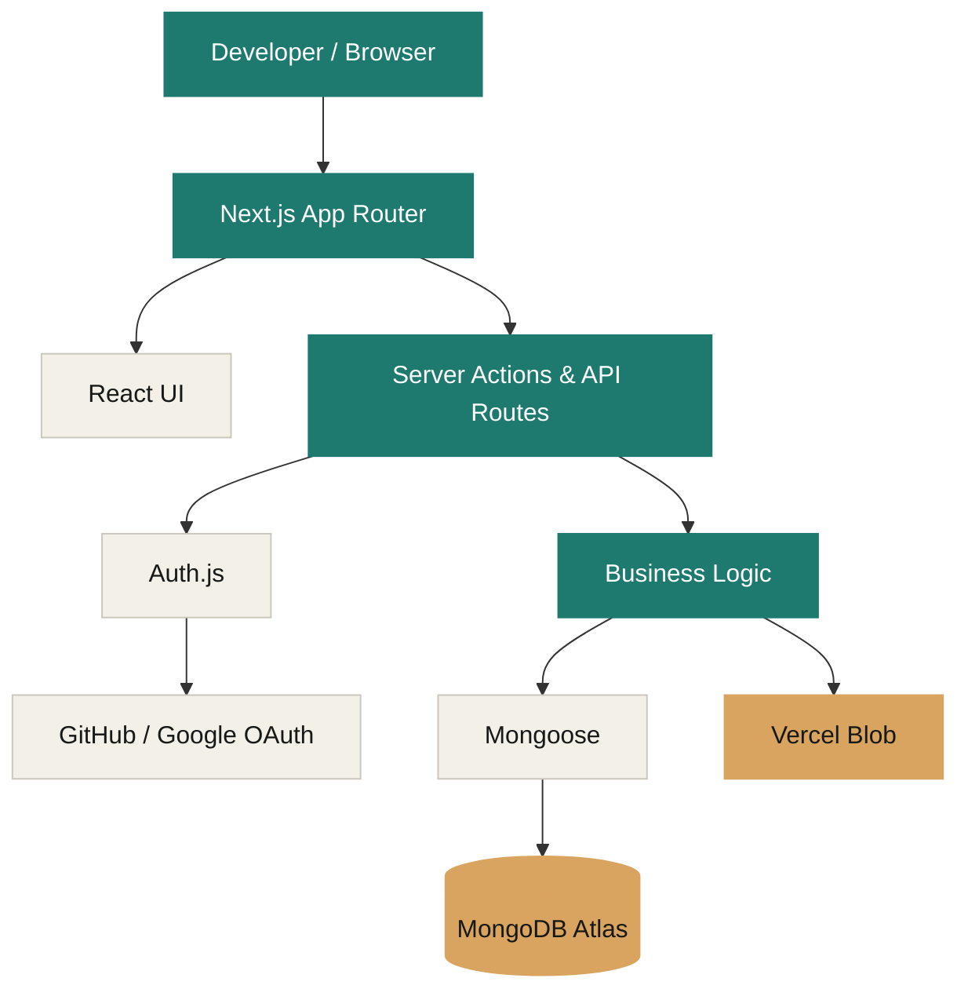
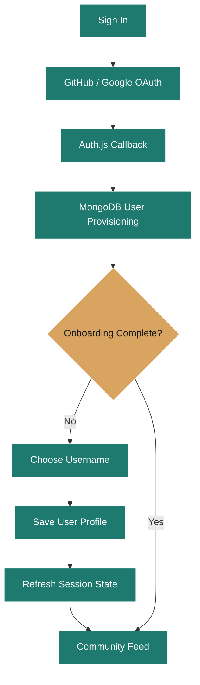

 <div align="center">

# DEVLOG_

### Build in motion.

**Projects show what you built. DevLog shows how you got there.**

A full-stack developer social platform for documenting progress, managing projects, sharing development journeys, and connecting with other developers.

[**Live Application**](https://devlog-delta-black.vercel.app/) · [**Design System**](https://devlog-delta-black.vercel.app/design) · [**Built By**](https://devlog-delta-black.vercel.app/built-by)


</div>

---

## The Idea

Most developer portfolios show the finished product.

But what about everything that happened before it was finished?

The debugging sessions. The architecture decisions. The features that failed. The milestones that finally worked.

**DevLog is built around that journey.**

It brings project portfolios, development updates, goal tracking, and community interactions into one place.

## Product Preview

> Screenshots will be added from the live application.

| Landing Page | Community Feed |
|:---:|:---:|
| Product introduction and design philosophy | Development posts and community interactions |
| Project Workspace | Developer Profile |
| Project details, goals, and progress | Projects, skills, posts, and developer identity |

## Features at a Glance

| Module | Capabilities |
|---|---|
| **Authentication** | GitHub OAuth, Google OAuth, JWT sessions, onboarding |
| **Projects** | Create, edit, delete, visibility, status, technology stack |
| **Project Goals** | Goal checklist, completion tracking, progress visualization |
| **Development Posts** | Project-linked updates, tags, images, editing and deletion |
| **Community Feed** | Cursor-based pagination, likes, comments, discussions |
| **Developer Discovery** | Search, suggested developers, follow/unfollow |
| **Profiles** | Bio, skills, tech stack, GitHub, portfolio and project history |
| **Design System** | Responsive layouts, light/dark themes, reusable components |

---

## Technology Stack

<div align="center">

| Frontend | Backend & Data | Infrastructure |
|:---:|:---:|:---:|
| Next.js | Next.js Server Actions | Vercel |
| React | MongoDB & Mongoose | MongoDB Atlas |
| TypeScript | Auth.js | Vercel Blob |
| Tailwind CSS | Zod | GitHub & Google OAuth |

</div>

## System Architecture



### Project Structure

```text
DevLog/
│
├── docs/                     # Product and engineering documentation
│
└── web/
    ├── public/               # Static assets
    └── src/
        ├── app/              # App Router, pages and API routes
        ├── components/       # Shared UI components
        ├── features/         # Feature-oriented modules
        │   ├── comments/
        │   ├── devlogs/
        │   ├── feed/
        │   ├── follows/
        │   ├── likes/
        │   ├── onboarding/
        │   ├── profile/
        │   ├── project-goals/
        │   ├── projects/
        │   └── search/
        ├── lib/              # Database and shared utilities
        ├── models/           # Mongoose schemas
        ├── types/            # TypeScript definitions
        └── auth.ts           # Auth.js configuration
```

---

## Engineering Highlights

### 01 / Authentication & Authorization

- GitHub and Google OAuth authentication with Auth.js
- JWT-based session management
- MongoDB-backed user provisioning
- Unique username onboarding
- Protected routes and ownership-based authorization

### 02 / Feed & Database Engineering

- Cursor-based feed pagination
- MongoDB aggregation pipelines
- Compound database indexes
- Privacy-aware project and post queries
- Zod-based input validation

### 03 / Media & Content Management

- Image uploads through Vercel Blob
- Rich-text comments
- Post creation, editing and deletion
- Image cleanup workflows
- Project-linked development history

### 04 / Production Engineering

DevLog is deployed on Vercel with MongoDB Atlas.

During production testing, an onboarding redirect loop was traced to stale JWT session state. The authentication callback was updated to synchronize onboarding status with MongoDB.

This debugging process is documented in the repository's Git history.

---

## Authentication Flow



## Local Development

**Prerequisites:** Node.js, npm, MongoDB, and OAuth credentials.

Clone the repository:

```bash
git clone https://github.com/alishacreates/DevLog.git
cd DevLog/web
npm install
```

Create `web/.env.local` using the variable names in `web/.env.example`.

Start the development server:

```bash
npm run dev
```

Open `http://localhost:3000`.

### Quality Checks

```bash
npm run lint
npx tsc --noEmit
npm run build
```

---

## Product & Engineering Documentation

DevLog was planned using a structured product-development process.

| Product Planning | Engineering |
|---|---|
| [Vision](docs/01_vision.md) | [Database Design](docs/08_database.md) |
| [Problem Statement](docs/02_problem.md) | [System Design](docs/09_system-design.md) |
| [User Personas](docs/03_userpersonas.md) | [API Design](docs/10_api.md) |
| [Product Requirements](docs/05_prd.md) | [Roadmap](docs/11_roadmap.md) |
| [Features](docs/06_features.md) | [SEO Plan](docs/17-seo-plan.md) |

## Roadmap

- [x] OAuth authentication and onboarding
- [x] Developer profiles and project management
- [x] Development posts and media uploads
- [x] Community feed and social interactions
- [x] Project Goals
- [x] Production deployment
- [ ] GitHub contribution calendar integration
- [ ] Improved post workspace and discussion experience
- [ ] Public access to developer profiles and projects
- [ ] Additional automated testing and performance improvements

## License

DevLog is proprietary software. See [LICENSE](LICENSE) for usage restrictions.

---

<div align="center">

### Built for developers who believe the process matters.

**[Explore DevLog](https://devlog-delta-black.vercel.app/)**

*Build in motion.*

</div>
